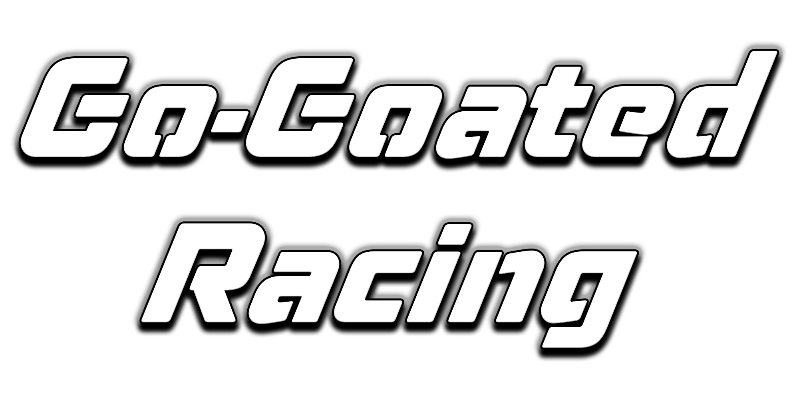

# Go-Goated Racing

A browser-based free-roam stunt driving game inspired by Madalin Stunt Cars 2 — loops, ramps,
and a half-pipe to mess around on, forgiving arcade car physics, real-time multiplayer with
friends on the same network, and zero install required.

**Play now:** **[toxinnozaki.github.io/StuntRush](https://toxinnozaki.github.io/StuntRush/)**



## Features

- **Free-roam stunt world** — loops, ramps, a half-pipe, a kicker jump, and a banked turn
  closing the main line into a circuit, all built from reusable modular track pieces
- **Active mid-air control** — hold Space and steer with arrows/mouse to flip and barrel-roll
  deliberately in the air, instead of being frozen in place the instant you leave the ground
  (the one thing MSC2 never let you do)
- **Fully rebindable controls** — remap every drive/action key from Settings; arrow keys always
  stay available as a fixed secondary air-control scheme
- **Local multiplayer** — see up to 3 other players driving the same world in real time over a
  direct peer-to-peer connection (WebRTC), with just a thin signaling relay to introduce you
- **Car customization** — pick a performance profile (Stock / Sport / GT, each a real
  power-vs-grip trade-off), any paint color via a live hue slider, and your own license plate
  text
- **Day/night + weather** — clear, cloudy, or snow (snow actually cuts tire grip, not just a
  visual layer), toggleable per map
- **PBR visuals** — clearcoat car paint, HDRI-driven lighting, soft shadows, and a light
  post-processing pass, aiming for photoreal rather than stylized
- Runs entirely client-side (WebGL2 + WASM physics) — no account, no install, works on
  Chromebook-class hardware

## Controls

| Action | Default key |
|---|---|
| Drive | WASD or Arrow keys |
| Air control (hold) + steer | Space + Arrow keys or mouse |
| Reset car | R |
| Headlights | H |

All of the above are rebindable from **Settings → Controls**.

## Tech stack

| Layer | Choice |
|---|---|
| Rendering | [Babylon.js](https://www.babylonjs.com/) (WebGL2) |
| Physics | Havok (via `@babylonjs/havok`, WASM) |
| Language | TypeScript |
| Build tool | Vite |
| Networking | WebRTC data channels + a Cloudflare Workers/Durable Objects signaling relay |
| Hosting | Static bundle on GitHub Pages, auto-deployed via GitHub Actions on every push |

## Running locally

```bash
npm install
npm run dev
```

Opens a dev server with hot reload. `npm run build` produces a production bundle in `dist/`
(type-checks with `tsc` first); `npm run preview` serves that build locally.

## Project status

v1 is feature-complete — see [DESIGN_DOC.md](DESIGN_DOC.md) for the full design doc, build
history, current status, and what's planned next. That file is the single source of truth for
where this project stands; if you're picking this project up cold, read it first.

## A note on assets

The car model, car sounds, and some world assets used here were sourced from various free/mod
community packs for a personal, non-commercial school project, not commissioned or licensed for
redistribution. If you fork this for your own public project, swap in assets you have clear
rights to use.
